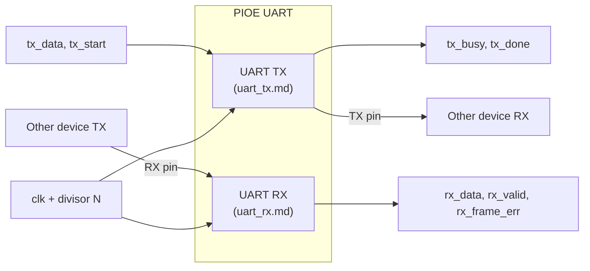

# UART — Protocol Specification (PIOE v1): Overview

> Status: **Draft v0.2** · Scope: TX + RX, 8N1, logic-level · Reference model for the PIOE ISA
>
> This spec is split into three files:
> - **`uart.md`** (this file): what UART is, frame format, baud math, the shared parts, ISA mapping, interview checklist
> - **[`uart_tx.md`](uart_tx.md)**: transmitter. Block diagram, final FSM, flowchart *(design final)*
> - **[`uart_rx.md`](uart_rx.md)**: receiver. Block diagram, full explanation, design worksheet *(design in progress)*

---

## 1. What UART is

**UART** = *Universal Asynchronous Receiver/Transmitter*.

- **Asynchronous:** there is **no clock wire**. Both sides agree in advance on a speed (the **baud rate**), and each side times bits with its own local clock.
- **Point-to-point, full-duplex:** two wires, one per direction. Both can talk at the same time.
- **No addressing, no acknowledgement:** the transmitter sends and assumes someone is listening. Reliability depends on matched baud rates and correct framing.

| Signal | Direction (from PIOE) | Idle level |
|---|---|---|
| `TX` | output | **High** (logic 1, called "mark") |
| `RX` | input | **High** |
| `GND` | shared | — |

> **UART vs RS-232 (common interview trap):** UART is the *protocol/framing*. RS-232 is an *electrical standard*: ±3 to ±15 V and **inverted** (logic 1 = negative voltage). PIOE speaks **logic-level UART** at the I/O voltage. Connecting it to a real RS-232 port needs a level shifter such as a MAX232. USB-to-UART cables (FTDI, CP2102, CH340) use logic levels and connect directly.

### 1.1 Top-level block diagram

A UART is **two independent machines** that share only the clock and the divisor N:

```
                       ┌──────────────── PIOE UART ────────────────┐
  tx_data[7:0] ───────▶│                                           │
  tx_start ───────────▶│   UART TX  (uart_tx.md)  ─────────────────┼──▶ TX pin ──▶ other device's RX
  tx_busy, tx_done ◀───│                                           │
                       │         clk ──┐      N (from program) ──┐ │
                       │               ▼                         ▼ │
  rx_data[7:0] ◀───────│                                           │
  rx_valid ◀───────────│   UART RX  (uart_rx.md)  ◀────────────────┼─── RX pin ◀── other device's TX
  rx_frame_err ◀───────│                                           │
                       └───────────────────────────────────────────┘
```



---

## 2. Frame format (8N1)

One character = **1 start bit + 8 data bits + no parity + 1 stop bit = 10 bit-times**.

```
 idle  start  D0   D1   D2   D3   D4   D5   D6   D7   stop  idle
 ‾‾‾‾‾|    |‾‾‾‾|    |‾‾‾‾|    |‾‾‾‾|    |‾‾‾‾|    |‾‾‾‾‾‾‾‾‾‾
      |____|    |____|    |____|    |____|    |____|
       0     1    0    1    0    1    0    1    0    1
       ^ falling edge = "a frame begins"          (example byte 0x55, LSB first)
```

| Field | Value | Why it exists |
|---|---|---|
| Idle | 1 | A broken or disconnected line reads 0, which is distinguishable from idle |
| Start bit | 0 | The 1→0 **falling edge** is the only timing reference the receiver gets. It re-synchronizes on every character |
| Data | 8 bits, **LSB first** | Convention |
| Parity | none (v1) | Optional single-bit error detection; deferred |
| Stop bit | 1 | Guarantees the line returns high, so the *next* start bit produces a fresh falling edge |

**Throughput:** 10 bit-times carry 8 data bits, so efficiency is **80%**. At 115200 baud that is 11 520 bytes/s.

**Why resync per character matters:** the two clocks only need to agree for about 10 bits, not forever. That is why UART can stay asynchronous.

---

## 3. Baud rate & timing at the PIOE clock

**The baud rate is not fixed in hardware.** PIOE generates no clock of its own; it only *divides* whatever `clk` the board supplies. The program in flash stores a divisor `N = round(f_clk / baud)`, computed by whoever writes the program, since they know the board clock. The hardware only sets the **range**:
- Fastest: a few cycles per bit, limited by how many instructions each bit needs.
- Slowest: set by the counter width, e.g. a 12-bit counter gives up to 4095 cycles/bit, which is ~4.9 kbaud at 20 MHz.

The table below is an **example** at the v1 target `f_clk = 20 MHz`.

| Baud | Ideal cycles/bit | Divisor N (rounded) | Actual baud | Error |
|---|---|---|---|---|
| 9600 | 2083.33 | 2083 | 9601.5 | +0.02% |
| 115200 | 173.61 | 174 | 114942.5 | −0.22% |
| 1 000 000 | 20.00 | 20 | 1 000 000 | 0.00% |

### Error budget: how wrong can the baud rate be?

The receiver syncs on the start edge, then samples each bit at its **middle**. Clock mismatch makes each sample drift a little further from mid-bit. The **last** sample (the stop bit) comes 9.5 bit-times after the edge, and it must still land inside its bit, i.e. drift less than ½ bit:

```
total mismatch  <  0.5 bit / 9.5 bits  ≈  5.2 %
```

Edge-detection uncertainty also eats part of that margin. With 16× oversampling the uncertainty is 1/16 bit, leaving about 4.6%. With PIOE's per-cycle counting it is 1/174 bit, which is negligible. The budget is shared between the two devices, so the usual rule is **≤ ±2% per side**. PIOE's −0.22% at 115200 is comfortable.

---

## 4. The parts box (shared by TX and RX)

Both machines are built from the same four parts:

1. **Baud timer `baud_cnt`: the stopwatch.**
   - Counts clocks 0 … N−1, raises `tick` ("one bit-time has passed"), then wraps to 0.
2. **Bit counter `bit_cnt` (3 bits): finger-counting.**
   - Which of the 8 data bits we're on.
3. **Data register (8 bits): the conveyor belt.**
   - Holds the byte being sent or collected.
4. **State register: the bookmark.**
   - Remembers which step we're in: IDLE, START, DATA or STOP.

**Stopwatch + finger-counter + belt + bookmark + rules for moving between steps = the whole UART.** The rules are the FSM.

TX and RX each get their **own** copy of these parts. They run at the same time and independently, so they cannot share a stopwatch.

---

## 5. What UART needs from the PIOE ISA (bottom-up extraction)

This is why we spec the FSMs first: each state becomes one or more **generic primitives**.

| FSM behaviour | Candidate primitive |
|---|---|
| Hold a pin level for N cycles | `SET pin, value` + `DELAY n` (or a delay field in every instruction) |
| Shift one bit out to a pin | `OUT pin, 1` (shift-register → pin) |
| Wait for a falling edge | `WAIT pin == 0` |
| Sample a pin into a register | `IN pin, 1` (pin → shift-register) |
| Repeat 8 times | loop counter + `JMP` on counter ≠ 0 |
| Hand a full byte to the other protocol | `PUSH` / `PULL` (byte handoff between the two sides) |

These rows will be compared against the SPI and I2C lists. Whatever all three share becomes the core ISA. Anything I2C needs that the generic primitives can't do cheaply (e.g. open-drain START/STOP) gets judged separately.

---

## 6. PIOE v1 parameters

| Parameter | Value |
|---|---|
| Format | 8N1, LSB first, idle high |
| Clock | 20 MHz (reference; user-supplied) |
| Baud | Programmable divisor N (from the flash program); 115200 is the reference |
| Valid N | **N ≥ 8 minimum, ≥ 16 recommended**, rounding error ≤ 2%. Documented, not enforced; N < 8 is undefined (see `uart_rx.md` §R.8a) |
| RX sampling | Edge + ½-bit / 1-bit delay counting, 2-FF synchronizer, ½-bit glitch check |
| Flow control (RTS/CTS) | Not supported in v1 |
| Pins | `TX` → a `uo_out` bit, `RX` → a `ui_in` bit (final pin map in spec v0.2) |

---

## 7. Interview checklist

1. *Why is UART "asynchronous", and how does the receiver stay in sync?* Each start-bit edge re-syncs it, and the clocks only need to agree for about 10 bits.
2. *Why sample in the middle of a bit?* That point has the most margin against drift and edge jitter.
3. *What is the maximum allowed baud mismatch?* About 5% in total, so about ±2% per side. Derive it from ½ bit over 9.5 bits.
4. *Why idle high?* A dead or broken line (reads 0) is distinguishable from idle, and the start bit's falling edge is clean.
5. *What is 16× oversampling and why do it?* It finds mid-bit precisely and allows a majority-vote noise filter.
6. *What is metastability, and why a 2-FF synchronizer?* An asynchronous input sampled at a clock edge can settle late. The second FF gives it a full cycle to resolve, which raises MTBF enormously.
7. *Framing error vs overrun vs break?* See `uart_rx.md` §R.7.
8. *UART vs RS-232?* Protocol vs electrical standard; RS-232 is inverted and uses ±12 V.
9. *Compute the divisor and error for 115200 baud at 20 MHz.* N=174, −0.22%.
10. *Why does a frame take exactly 10 × N clocks?* 1 start + 8 data + 1 stop, N clocks each.
