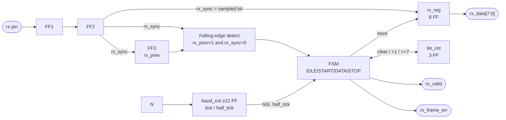
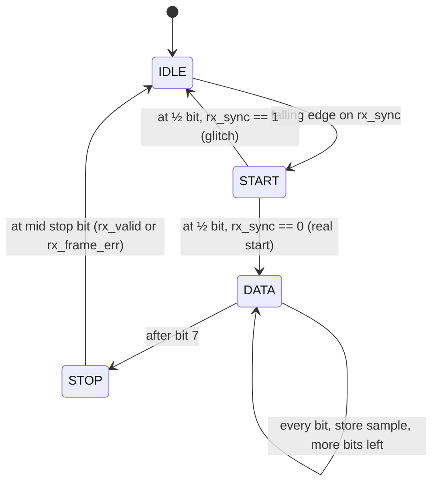
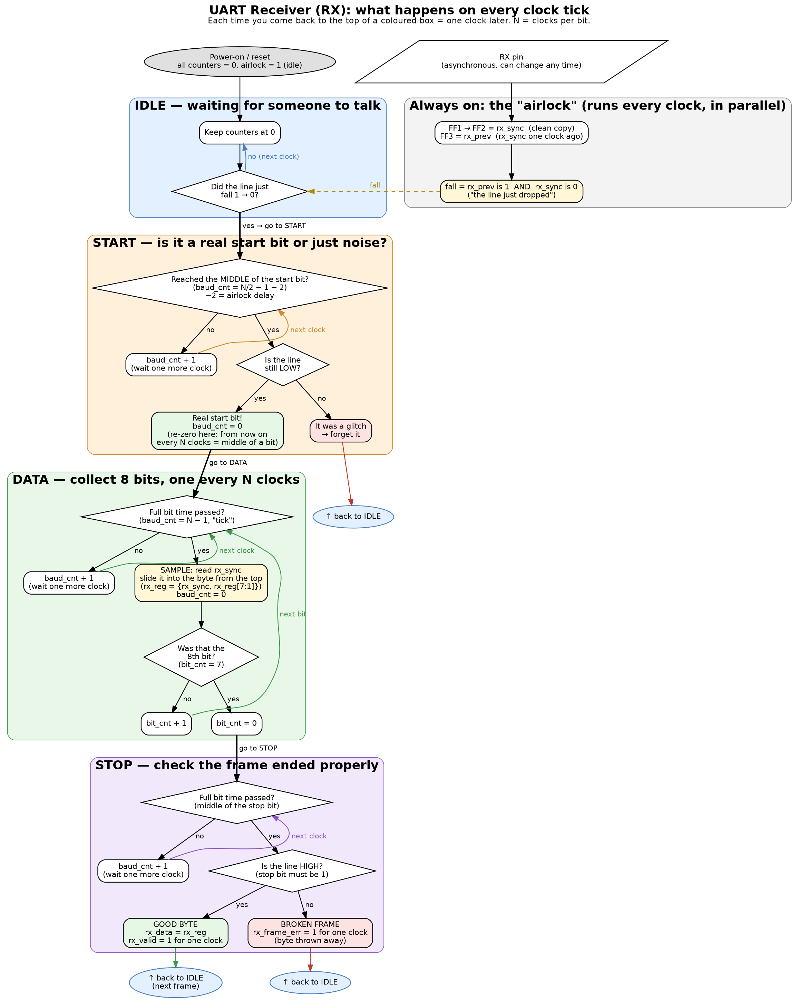
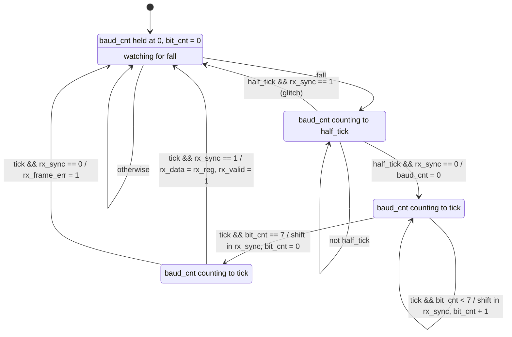
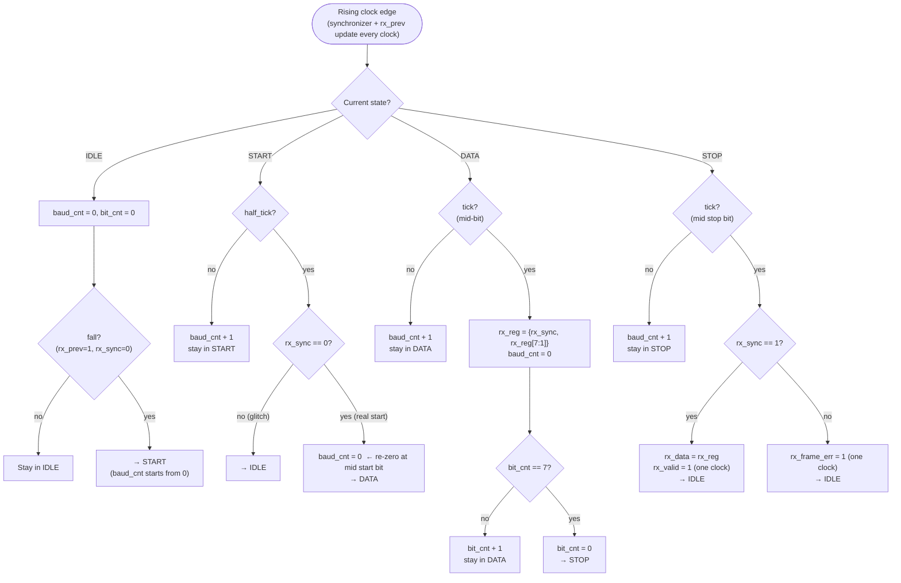

# UART RX — Receiver Specification (PIOE v1)

> Status: **Design final (v1)**, §R.10. The worksheet in §R.9 is kept as a self-test · Overview and shared material: [`uart.md`](uart.md)

---

## R.1 Job in one sentence
Watch one input pin, notice when a frame starts, read each of the 8 bits at the **middle** of its bit-time, check the stop bit, and hand the finished byte to the inside of the chip.

## R.2 Why RX is harder than TX

| | TX (speaking) | RX (listening) |
|---|---|---|
| Who decides when things happen? | **TX itself**: it starts when *it* is told `tx_start` | **The other device**: RX has to *notice* the start |
| Whose clock is the pin on? | Ours | **Theirs**, so it can change at any moment |
| Can the input be wrong? | No, we drive it | **Yes**: noise, glitches, wrong baud rate |
| Does it need to decide anything? | No, just send | **Yes**: is this start real? Is the stop bit good? |

So RX needs everything TX has, **plus three new things**: an input cleaner (synchronizer), an edge detector, and a half-bit timer.

## R.3 The parts

**The same four parts as TX** (see `uart.md` §4):
- **`baud_cnt` + `tick`:** the stopwatch, counting N clocks per bit.
- **`bit_cnt`:** which bit we're on (0–7).
- **`rx_reg`:** the belt that collects the 8 bits.
- **`state`:** IDLE / START / DATA / STOP.

**Plus three new parts:**
1. **Synchronizer (2 flip-flops in a row), the "airlock".** The pin goes in, and a clean, safe copy called `rx_sync` comes out 2 clocks later.
2. **Edge detector (1 more flip-flop + a small gate).** It remembers last clock's `rx_sync` as `rx_prev`. "Was 1, now 0" means a falling edge, i.e. a frame is starting.
3. **`half_tick`.** The same stopwatch, but the flag fires after **half** a bit-time instead of a full one.

## R.4 Block diagram

```
                ┌────────────────────────────── UART RX ──────────────────────────────┐
                │                                                                      │
 rx (pin) ──────┼──▶ [FF1] ──▶ [FF2] ──┬── rx_sync ───────────────────┐                 │
                │    └── synchronizer ──┘    │                        │ sampled bit     │
                │                            ▼                        ▼                 │
                │                      [FF3] rx_prev        [ rx_reg (8 FF) ] ──────────┼──▶ rx_data[7:0]
                │                            │                   ▲ store/shift          │
                │                            ▼                   │                      │
                │                   falling edge detect          │                      │
                │                  (rx_prev==1 && rx_sync==0)    │                      │
                │                            │                   │                      │
                │                            ▼                   │                      │
                │                    ┌───────────────────────────┴──┐                   │
                │                    │              FSM             │───────────────────┼──▶ rx_valid
                │                    │ IDLE → START → DATA → STOP   │───────────────────┼──▶ rx_frame_err
                │                    └──▲─────────────▲─────────────┘                   │
                │              tick,    │             │ clear / +1 / ==7                │
                │           half_tick   │        [ bit_cnt (3 FF) ]                     │
 N ─────────────┼──▶ [ baud_cnt (≥12 FF) ]                                              │
                │      tick      = (baud_cnt == N−1)                                    │
                │      half_tick = (baud_cnt == N/2 − 1)                                │
                └──────────────────────────────────────────────────────────────────────┘
```



**Rough cost:** synchronizer + edge 3 + `rx_reg` 8 + `rx_data` 8 (or reuse `rx_reg`) + `bit_cnt` 3 + `baud_cnt` 12 + state 2 = **~28–36 flip-flops**.

## R.5 The full story of one received byte (plain language)

### Stage 0: the airlock (synchronizer), always running
- The other device's clock is not our clock, so the `rx` pin can change at **any instant**, including the exact instant our flip-flop samples it.
- When that happens, the flip-flop can get stuck "in between" 0 and 1 for a short, unpredictable time. That is **metastability**. Logic reading that confused value could see 0 in one place and 1 in another, and the whole FSM can break.
- **Fix: pass the pin through two flip-flops.**
  - The first one might get confused, but it has a **whole clock period** to settle before the second one copies it.
  - The second one's output, **`rx_sync`**, is clean.
- **Rule: nothing else in RX ever looks at the raw pin. Everything uses `rx_sync`.**
- Cost: the signal arrives 2 clocks late. Compared with N = 174 clocks per bit that's nothing, and it delays every bit equally, so the timing doesn't change.

### Stage 1: IDLE (waiting for someone to speak)
- The line sits at 1 (idle). RX does nothing except watch for the **falling edge**: `rx_prev` was 1 and `rx_sync` is now 0.
- Why look for the *edge* and not just "line is 0"? The edge marks the **exact moment** the start bit began. That moment is the zero point for all the timing that follows.
- On the edge: start the stopwatch from 0 and go to START.

### Stage 2: START (is it real?)
- We know *when* the start bit began, but it might be fake: a tiny noise spike that dropped the line for a couple of clocks.
- So we wait **half a bit-time** (`half_tick`) and look again. We're now in the **middle** of the start bit:
  - **Line still 0:** it's a real start bit. Go to DATA.
  - **Line back to 1:** it was a glitch. Forget it and go back to IDLE.
- **Second benefit:** we are now standing **exactly in the middle of a bit**. From here, stepping forward one full bit-time at a time lands in the middle of every following bit. The half-bit wait is how we "line up" with the middles.

### Stage 3: DATA (catch 8 bits)
- Wait one full bit-time (`tick`). We're now in the middle of **bit 0**: read `rx_sync` and store it.
- Wait another full bit-time: middle of **bit 1**. Read and store. And so on until **bit 7**.
- `bit_cnt` keeps track of how many bits we've caught, and after bit 7 we go to STOP.
- **Where to store each bit:** bits arrive LSB first (bit 0 first). Either:
  - put each bit straight into its slot, `rx_reg[bit_cnt]`, or
  - push each new bit in at the **top** of `rx_reg` and shift everything down one place. After 8 pushes, the first bit (bit 0) has been pushed all the way down to position 0. It's the queue picture: the first person in line ends up at the front.

### Stage 4: STOP (check the ending)
- Wait one more full bit-time. We're in the middle of the **stop bit**, which must be **1**.
  - **It's 1:** the frame is good. Copy the byte to `rx_data` and fire `rx_valid` for **one clock**: "new byte here!"
  - **It's 0:** something's wrong (the baud rates don't match, noise, or the other side sent a "break"). Fire `rx_frame_err` for one clock and throw the byte away.
- **Go back to IDLE immediately, at the middle of the stop bit.** Don't wait for its end. The other device may send the next start bit right after this stop bit. Leaving early gives us half a bit of spare time to be back in IDLE, ready to catch that next falling edge.

### Timing picture

```
 line: ‾‾‾‾‾‾|________________|‾‾‾‾‾‾‾‾‾‾‾‾‾‾‾‾|________________|  ...  |‾‾‾‾‾‾‾‾‾‾‾‾‾‾‾‾|‾‾‾‾
             |<- start bit -->|<--- bit 0 ---->|<--- bit 1 ---->|  ...  |<-- stop bit -->|
             ^       ^                ^                ^                        ^
           edge    check           sample           sample                   check
         (IDLE)   (½ bit:         (+1 bit:         (+1 bit:                 (+1 bit after
                  real start?)     middle of b0)    middle of b1)            bit 7) → IDLE
```

## R.6 Two ways to find the middle of a bit (design choice)

| Approach | How | Pros | Cons |
|---|---|---|---|
| **A. 16× oversampling** (classic UART IP) | Sample 16× per bit; confirm the start after 8 low samples; read each bit at sample 8, often with a 3-sample majority vote | Noise-tolerant (majority vote), standard textbook answer | Needs a ×16 tick generator, more logic |
| **B. Edge + delay counting** (PIO style) | On the falling edge, wait **½ bit** (check start), then sample every **1 bit** | Very small; uses the same counter as TX; maps directly to "wait N cycles" instructions | No majority vote, so less immune to glitches |

**PIOE choice: B.** The ISA engine will already have a cycle-delay counter, and B uses only that. Approach A is documented because interviewers expect you to know it.

## R.7 What can go wrong

| Problem | What it looks like | v1 handling |
|---|---|---|
| **Metastability** | Pin changes exactly at our clock edge | 2-FF synchronizer |
| **Glitch / false start** | Line dips to 0 for a few clocks | ½-bit re-check in START → back to IDLE |
| **Framing error** | Stop bit read as 0: baud mismatch, noise, or *break* | `rx_frame_err` pulse; byte discarded |
| **Break** | Line held low longer than a whole frame | Shows up as a framing error in v1 |
| **Overrun** | Next byte finishes before the previous one was taken | No FIFO (spec §5). The program must take each byte within ~1 frame time |
| **Missed next start** | Staying in STOP until the end of the stop bit | Leave STOP at the *middle* of the stop bit |
| **Parity error** | — | N/A (no parity in v1) |

## R.8 Reference sketch (high level; the detailed FSM comes from the user's design)



## R.8a Valid range of N (documented, not enforced). See ERROR_LOG E-006

| Limit | Value | Meaning |
|---|---|---|
| **N_min (hard minimum)** | **8** | Below this, RX is **not guaranteed to work** |
| **N_rec (recommended)** | **≥ 16** | Comfortable margin for edge uncertainty |
| **Accuracy rule (always)** | \|N − f_clk/baud\| ÷ (f_clk/baud) **≤ 2%** | The rounded N must still meet the per-side baud budget |

**Why a minimum exists**
1. **Fixed front-end delay:** the synchronizer and edge detect see the edge ~2–3 clocks late. At N=4 the ½-bit check would land after the start bit has ended. The design subtracts this known latency from the ½-bit wait, which only works if N/2 is comfortably larger than the latency.
2. **Edge uncertainty:** the real edge can fall anywhere within one clock, giving a fixed error of 1/N bit. That's 12.5% at N=8 and 6.25% at N=16, eaten from the ½-bit margin.
3. **Rounding:** N is an integer, so the baud error can reach 0.5/N. That's only safe at small N when f_clk is (nearly) an exact multiple of the baud rate, hence the accuracy rule.
4. **Odd N:** ½ bit is computed as `N >> 1` (rounds down). Exact at even N; the ½-clock offset is negligible from N ≥ 8.

**Enforcement policy:** **documented only**. The hardware does not clamp N. Choosing a valid N (≥ 8, ideally ≥ 16, meeting the accuracy rule) is the program author's responsibility. Behaviour with N < 8 is **undefined**.

TX alone would work down to N = 1 (it never samples), but the PIOE UART limit is set by RX.

**Example (f_clk = 20 MHz):** 115200 baud → N = 174 ✅. 1 Mbaud → N = 20 ✅ (exact). 2.5 Mbaud → N = 8 ✅ only because 20 MHz / 2.5 MHz is exact. 3 Mbaud → N = 6.67 ❌ (below N_min, and the rounding error is 10%).

## R.9 Design worksheet (to be answered by the user)

**Step 1: interface.** For each signal in §R.4, note who drives it (pin, FSM or counter).

**Step 2: front end.**
- Q1: Write the falling-edge condition using `rx_sync` and `rx_prev`.
- Q2: Why must the FSM never use `rx` directly?

**Step 3: per state**, answer: what am I waiting for → what do I do while waiting → what do I check → where do I go for each result, and with what action? (START and STOP each have **two** exits.)

**Step 4: specific questions**
- IDLE: what are `baud_cnt` and `bit_cnt` here? What single condition goes to START?
- START:
  - `tick` or `half_tick`?
  - How do you build `half_tick` from N without a divider?
  - What does each `rx_sync` value at the check mean?
  - **What must `baud_cnt` be set to when leaving for DATA, so the next `tick` lands in the middle of bit 0?**
- DATA:
  - What do you read, and where do you store it: `rx_reg[bit_cnt]` or shift-in?
  - If you shift in, which end does the new bit enter?
  - What is the exit condition (the TX lesson)?
- STOP:
  - What value means good?
  - What goes to `rx_data`, and which pulse fires?
  - Should pulses be written inside the state or on the arrow?
  - Why leave at mid-stop?

**Step 5: timing check with N = 8.** The edge is seen at clock 0. Fill in the clock at which each event happens; all of them should be bit middles (4, 12, 20, …).

| Event | Clock |
|---|---|
| START check | ? |
| Sample bit 0 | ? |
| Sample bit 1 | ? |
| … bit 7 | ? |
| Stop check | ? |

**Step 6: draw it** in the same per-clock flowchart format as `uart_tx.md` §T.5. Walk through "A" (start 0, then 1,0,0,0,0,0,1,0, then stop 1) and **one glitch** (line low for only 2 clocks).

---

## R.10 Final RX design (v1)


*Picture version of the per-clock flowchart below (source: `img/uart_rx_flow.dot`).*

### Signals
| Name | Width | Dir | Role |
|---|---|---|---|
| `clk`, `rst_n` | 1 | in | System clock, active-low reset → IDLE |
| `N` | ≥12 | in | Clocks per bit, from the program (N ≥ 8, see §R.8a) |
| `rx` | 1 | in | Serial pin (asynchronous) |
| `rx_sync` | 1 | internal | `rx` after the 2-FF synchronizer |
| `rx_prev` | 1 | internal | `rx_sync` delayed by 1 clock |
| `fall` | 1 | internal | `rx_prev == 1 && rx_sync == 0` (falling edge) |
| `baud_cnt` | ≥12 | internal | Bit-time stopwatch |
| `tick` | 1 | internal | `baud_cnt == N − 1`: full bit-time over |
| `half_tick` | 1 | internal | `baud_cnt == (N >> 1) − 1 − LAT`: half bit, latency-compensated |
| `LAT` | const | — | **2**, the synchronizer delay subtracted from the half wait |
| `bit_cnt` | 3 | internal | Which data bit (0–7) |
| `rx_reg` | 8 | internal | Collects bits (shift-in) |
| `rx_data` | 8 | out | Last good byte (held until the next good byte) |
| `rx_valid` | 1 | out | **1-clock pulse**: `rx_data` just updated |
| `rx_frame_err` | 1 | out | **1-clock pulse**: stop bit was 0, byte discarded |
| `state` | 2 | internal | IDLE / START / DATA / STOP |

### State diagram
Labels show *condition / action*. Actions on arrows happen once (Mealy-style); text inside a state holds for the whole state.



### Per-clock flowchart


### Timing check (N = 8, LAT = 2; times measured from the *true* line edge)

| Event | Clock | Bit window | Position |
|---|---|---|---|
| Edge seen (`fall`) → START | ~2 | start: 0–7 | (synchronizer delay) |
| START check (`half_tick`) | 4 | start: 0–7 | middle ✓ |
| Sample bit 0 | 12 | 8–15 | middle ✓ |
| Sample bit 1 | 20 | 16–23 | middle ✓ |
| … bit k | 12 + 8k | | middle ✓ |
| Sample bit 7 | 68 | 64–71 | middle ✓ |
| Stop check → IDLE | 76 | stop: 72–79 | middle ✓ |
| Earliest next start edge | 80 | | IDLE again since 77 ✓ |

Times are ±1 clock: the true edge can fall anywhere inside a clock period, and the flip-flop pipeline adds whole-clock steps. Exact cycle numbers are confirmed in simulation.

### Design decisions
- **Shift-in storage** (`rx_reg = {rx_sync, rx_reg[7:1]}`): each new bit enters at bit 7 and moves down. After 8 shifts, the first bit (LSB) is at bit 0. Chosen over `rx_reg[bit_cnt] = rx_sync` because it needs no write decoder. (TX uses a read mux, the mirror of this.)
- **Separate `rx_data` register (+8 FF):** `rx_reg` is free to collect the next frame while the program still reads the previous byte, which gives a whole frame time (10 × N clocks) before overrun. Saving the 8 FF by reusing `rx_reg` would cut that window to about 1.5 bit-times.
- **The edge detector is only used in IDLE.** Inside a frame, line transitions are data, not starts.
- **`baud_cnt` is re-zeroed twice per frame:** on `fall` (IDLE→START) and at mid start bit (START→DATA). After that it wraps naturally every N clocks, and every wrap is a bit middle.
- **Leave STOP at mid stop bit**, giving ½ bit of margin to catch a back-to-back start edge.
- **`LAT` compensation** keeps the samples centred even at small N. At N = 174 it is negligible but harmless.
- **Rough cost:** 3 (sync + prev) + 8 (`rx_reg`) + 8 (`rx_data`) + 3 (`bit_cnt`) + 12 (`baud_cnt`) + 2 (state) = **~36 FF**, plus two comparators and an incrementer.
