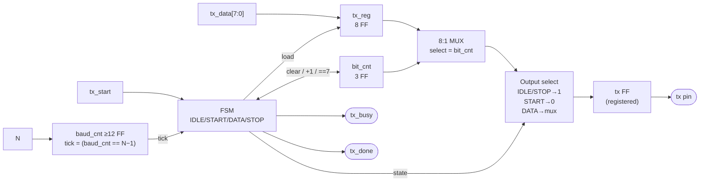
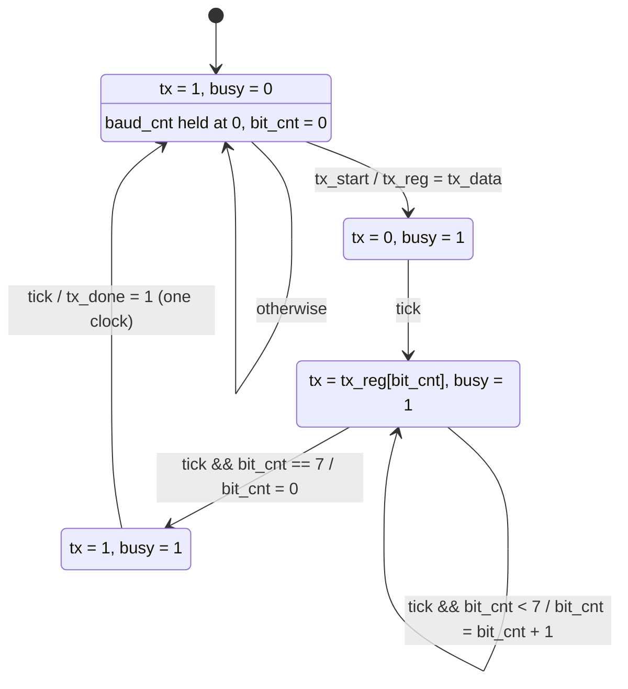
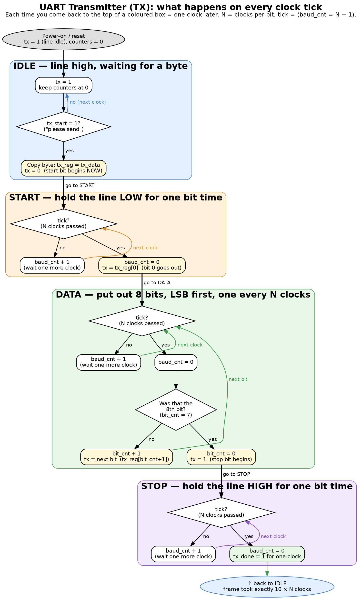
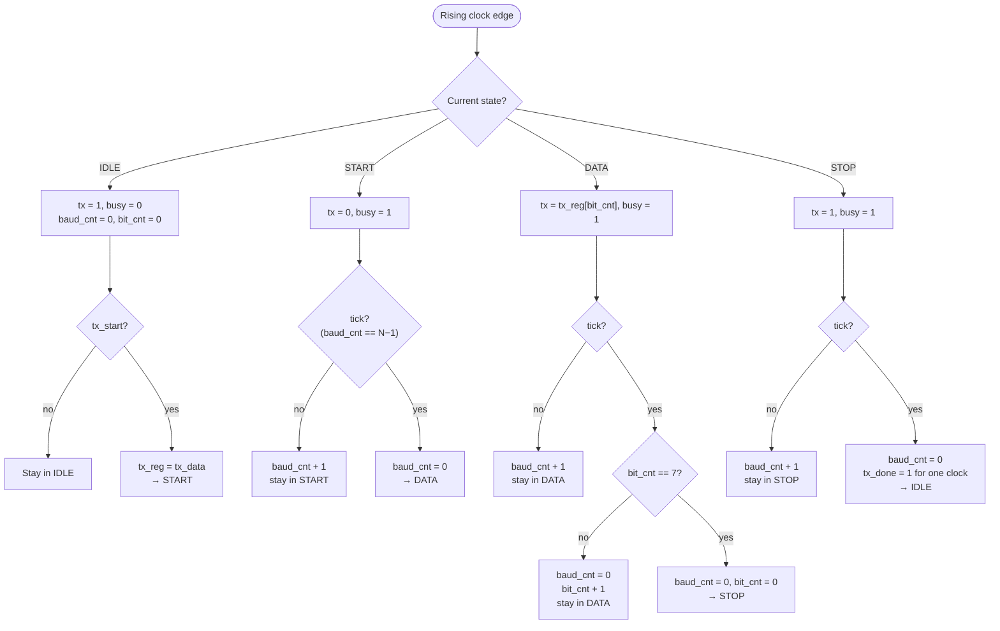

# UART TX — Transmitter Specification (PIOE v1)

> Status: **Design final** (paper iterations 1–3, review history in ERROR_LOG E-005) · Overview and shared material: [`uart.md`](uart.md)

---

## T.1 Job in one sentence
Take a byte from inside the chip and send it out of one pin as a 10-bit frame (start 0, 8 data bits LSB first, stop 1), holding each bit for exactly N clocks.

## T.2 Interface & internal signals

| Name | Width | Dir | Role |
|---|---|---|---|
| `clk` | 1 | in | System clock (user-supplied) |
| `rst_n` | 1 | in | Active-low reset → IDLE |
| `N` | ≥12 | in | Clocks per bit, from the program |
| `tx_data` | 8 | in | Byte to send |
| `tx_start` | 1 | in | Go (sampled in IDLE only) |
| `tx` | 1 | out | Serial pin (**registered**) |
| `tx_busy` | 1 | out | 1 in START/DATA/STOP |
| `tx_done` | 1 | out | **1-clock pulse** when the frame finishes |
| `tx_reg` | 8 | internal | Private copy of the byte, latched on `tx_start` |
| `baud_cnt` | ≥12 | internal | Counts 0 … N−1, then wraps |
| `tick` | 1 | internal | `baud_cnt == N−1`: one bit-time over |
| `bit_cnt` | 3 | internal | Which data bit (0–7) |
| `state` | 2 | internal | IDLE / START / DATA / STOP |

## T.3 Block diagram

```
                ┌───────────────────────────── UART TX ─────────────────────────────┐
                │                                                                    │
 tx_data[7:0] ──┼──▶ [ tx_reg (8 FF) ] ──▶ [ 8:1 MUX ] ──┐                           │
                │        ▲ load                ▲ select   │ data bit                  │
                │        │                     │          ▼                           │
                │        │               [ bit_cnt ]   [ OUTPUT SELECT ]              │
                │        │                 (3 FF)       IDLE/STOP → 1                 │
                │        │                     ▲        START     → 0                 │
                │        │                     │        DATA      → mux bit           │
                │        │                     │          │                           │
 tx_start ──────┼──▶ ┌───┴─────────────────────┴───┐      ▼                           │
                │    │             FSM             │──▶ [ tx FF ] ─────────────────────┼──▶ tx (pin)
                │    │  IDLE → START → DATA → STOP │      (registered output)          │
                │    └───▲──────────┬──────────────┘                                   │
                │        │ tick     ├──────────────────────────────────────────────────┼──▶ tx_busy
                │        │          └──────────────────────────────────────────────────┼──▶ tx_done
 N ─────────────┼──▶ [ baud_cnt (≥12 FF) ]                                             │
                │      tick = (baud_cnt == N−1)                                        │
                └────────────────────────────────────────────────────────────────────┘
```



**Rough cost:** `tx_reg` 8 + `bit_cnt` 3 + `baud_cnt` 12 + state 2 + `tx` 1 = **~26 flip-flops**, plus an 8:1 mux, a 12-bit comparator and an incrementer.

## T.4 State diagram (final)

Labels show *condition / action*. Actions on arrows happen once, at the transition (Mealy-style); outputs inside states hold for the whole state (Moore-style).



## T.5 Per-clock flowchart (final)

What the hardware decides on *every* clock edge.


*Picture version (source: `img/uart_tx_flow.dot`). The text version follows.*



## T.6 Design notes
- `baud_cnt` wraps N−1 → 0 by itself, so every state change lands exactly on a wrap. No separate timer reset is needed between states.
- `bit_cnt` is 3 bits, so it would wrap 7 → 0 naturally. It is still cleared explicitly (on DATA→STOP and in IDLE) to make the intent obvious.
- Each frame takes exactly **10 × N clocks** from START entry to IDLE re-entry. This is a good testbench check.
- **Registered output:** `tx` comes from a flip-flop, so state changes can't glitch the pin.
- **`tx_start` while busy** is ignored (it is only sampled in IDLE). `tx_busy` tells the rest of the chip to wait.
- **Bit selection:** an 8:1 mux indexed by `bit_cnt` was chosen. The alternative is a right-shifting `tx_reg` sending `tx_reg[0]`, which has the same FF count and swaps the mux for shift wiring.

## T.7 Plain-language walkthrough

**State 1: IDLE (light ON)**
- **Pin:** 1, the "nobody is talking" signal.
- **On `tx_start`:** copy `tx_data` into `tx_reg` *now* (so later changes can't corrupt the frame), → START.

**State 2: START (light OFF for one bit-time)**
- **Pin:** 0. The 1→0 drop is the "attention!" signal to the listener.
- **On `tick`:** → DATA.

**State 3: DATA (8 bits, one per bit-time)**
- **Pin:** `tx_reg[bit_cnt]`, bit 0 first.
- **On each `tick`:** `bit_cnt + 1`.
- **Leave:** after bit 7's tick → STOP.
- **Key idea:** ONE state for 8 bit-times. A counter replaces 8 copies of the same state.

**State 4: STOP (light ON for one bit-time)**
- **Pin:** 1. It forces the line high, so the *next* start bit always makes a fresh 1→0 drop.
- **On `tick`:** pulse `tx_done`, → IDLE.

**Walk-through: sending "A"** (0x41 = `0100 0001`; LSB first: 1,0,0,0,0,0,1,0)

| Bit-time | State | Pin |
|---|---|---|
| before | IDLE | 1 |
| 1 | START | 0 |
| 2–9 | DATA bits 0–7 | 1,0,0,0,0,0,1,0 |
| 10 | STOP | 1 |
| after | IDLE | 1 |
